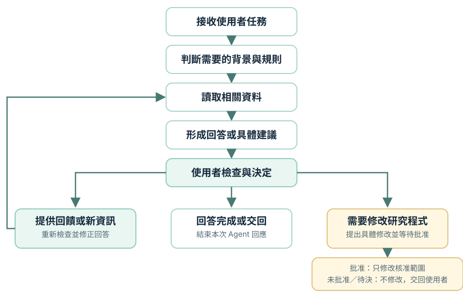

# Agent 工作流程與回饋

以下概念圖依工作空間的角色分工、資料選讀與操作權限整理；不是已部署或自動強制執行的程式。

1. 接收使用者任務，判斷需要哪些背景、規則與讀取權限。
2. 讀取相關資料，形成回答或具體建議，交給使用者檢查。
3. 使用者提供回饋或新資訊時，回到資料檢查並修正；回答完成或需要使用者處理時，結束本次回應或交回。
4. 若需要修改正式研究程式，先提出具體修改並等待批准；未批准或尚未決定時不修改。批准後只處理核准範圍，科學分析仍需明確授權。

這是對工作規則的綜合說明，不代表已執行科學分析或驗證結果。可在[教學展示頁的流程圖](../../presentation.html#s7)查看同一張圖與解說。

## 相關條目

- [Agent 與使用者](agent-user.md)
- [記憶與資料選讀](memory.md)
- [操作權限](permissions.md)
- [研究驗證流程](research-validation.md)

來源：[工作空間概覽](../sources/01-workspace.md)、[Agent 工作協議](../sources/02-working-agreement.md)、[研究驗證流程](../sources/04-research-validation.md)。
